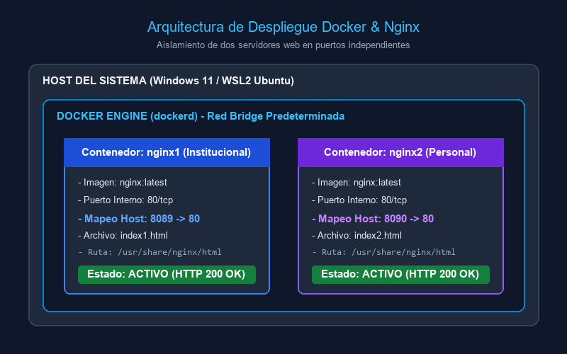
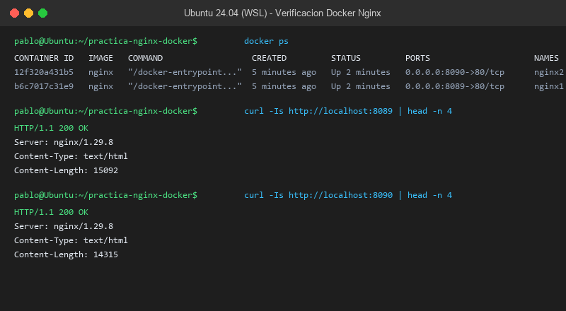
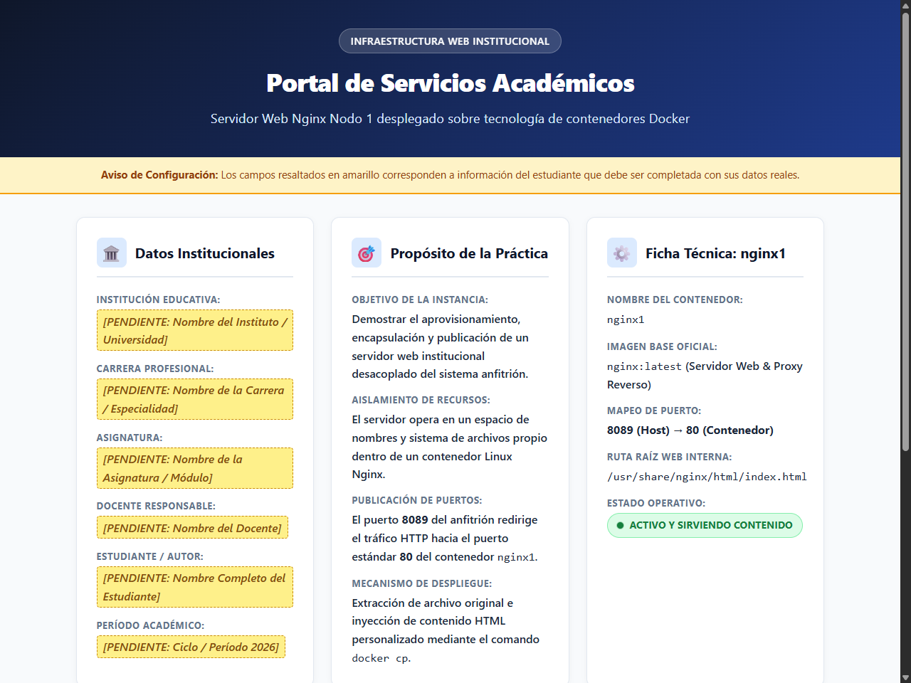
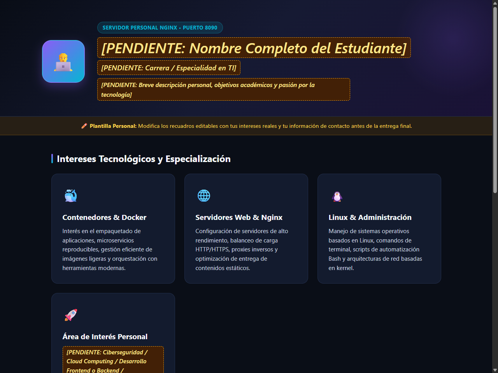

# Práctica: Servidor Web con Nginx y Docker

---

## Portada y Datos Informativos
- **Institución Educativa:** `[PENDIENTE: Nombre del Instituto / Universidad]`
- **Carrera / Especialidad:** `[PENDIENTE: Nombre de la Carrera / Especialidad en TI]`
- **Asignatura / Módulo:** `[PENDIENTE: Nombre de la Asignatura (ej. Tendencias Tecnológicas / Redes / DevOps)]`
- **Ciclo / Nivel:** `[PENDIENTE: Nivel / Semestre Académico]`
- **Docente:** `[PENDIENTE: Nombre del Docente]`
- **Estudiante (Autor):** `[PENDIENTE: Nombre Completo del Estudiante]`
- **Fecha de Realización:** 19 de octubre de 2026
- **Repositorio Propuesto:** `practica-nginx-docker`

---

## 1. Título
**Creación y personalización de dos servidores web con Nginx usando Docker**

---

## 2. Tiempo de Duración
- **Tiempo estimado de desarrollo:** 75 minutos.
- **Distribución de tiempo:**
  - Inspección del entorno y configuración de WSL2/Docker: 15 minutos.
  - Creación de páginas HTML responsivas (institucional y personal): 20 minutos.
  - Despliegue de contenedores, mapeo de puertos y copia con `docker cp`: 15 minutos.
  - Verificación de estado, pruebas HTTP y generación de evidencias: 15 minutos.
  - Grabación y calibración del audio de reflexión (60s) y documentación: 10 minutos.

---

## 3. Fundamentos Teóricos e Introducción

La virtualización a nivel de sistema operativo, popularmente conocida como tecnología de **contenedores**, representa uno de los paradigmas arquitectónicos más importantes en la computación en la nube moderna y las prácticas de DevOps. A diferencia de la virtualización clásica o tradicional basada en hipervisores (como VMware, VirtualBox o KVM) —en la cual cada máquina virtual emula hardware completo y ejecuta una copia íntegra de un sistema operativo huésped con su propio kernel—, los contenedores operan compartiendo directamente el núcleo del sistema operativo anfitrión (*host kernel*).

Para lograr este aislamiento sin la sobrecarga computacional de una máquina virtual, el kernel de Linux implementa dos mecanismos fundamentales:
1. **Espacios de nombres (Namespaces):** Proporcionan aislamiento en los recursos que los procesos pueden "ver". Existen espacios de nombres para identificadores de procesos (`PID`), redes (`NET`), sistemas de archivos y puntos de montaje (`MNT`), comunicación entre procesos (`IPC`) y nombres de host (`UTS`). Cada contenedor habita en su propio namespace de red, lo que le confiere una interfaz de red virtual independiente, tabla de enrutamiento propia y espacio de puertos privado.
2. **Grupos de control (Cgroups):** Se encargan de controlar, limitar y medir los recursos computacionales que un grupo de procesos puede "usar", tales como cuotas de procesador (CPU), memoria RAM, ancho de banda de red y operaciones de entrada/salida a disco (I/O).

En esta arquitectura entra en juego **Nginx**, un servidor web de código abierto, proxy inverso y balanceador de carga caracterizado por su arquitectura dirigida por eventos (*event-driven*) y asíncrona. A diferencia de servidores tradicionales basados en hilos o procesos por petición (como las versiones clásicas de Apache), Nginx maneja miles de conexiones HTTP concurrentes con una huella de memoria extremadamente reducida. 

Al empaquetar Nginx dentro de una imagen de Docker, se obtiene una unidad de software inmutable, portátil y autosuficiente que contiene el binario del servidor web, sus librerías de enlace dinámico y sus ficheros de configuración por defecto. Mediante el mecanismo de **mapeo de puertos** (`-p host:container`), el demonio de Docker (`dockerd`) configura reglas de traducción de direcciones de red (`iptables`/`nftables` en Linux) para reenviar los paquetes que ingresan por puertos específicos del anfitrión hacia la dirección IP interna y puerto 80 del contenedor correspondiente, permitiendo ejecutar múltiples servidores web simultáneos en el mismo equipo físico sin ningún conflicto de puertos.

---

## 4. Conocimientos Previos
Para la correcta comprensión y ejecución de esta práctica se requiere:
- **Comandos básicos de terminal Linux:** Navegación en directorios (`cd`, `ls`, `pwd`), lectura de archivos (`cat`, `grep`) y permisos de ejecución (`chmod`).
- **Conceptos de redes y protocolo HTTP:** Direcciones IP, puertos de escucha, solicitudes GET, encabezados HTTP y códigos de estado (200 OK, 404 Not Found).
- **Manejo básico de Docker CLI:** Sintaxis de comandos `docker run`, `docker ps`, `docker cp`, `docker stop` y ciclo de vida de imágenes y contenedores.
- **Estructuración Web (HTML5 y CSS):** Estructura básica de etiquetas, diseño adaptable a dispositivos móviles (meta viewport) y estilización con hojas de estilo.
- **Control de Versiones (Git y GitHub):** Inicialización de repositorios locales, seguimiento de cambios, commits y sincronización con repositorios remotos.

---

## 5. Objetivos a Alcanzar

### Objetivo General
Implementar, configurar y personalizar dos servidores web Nginx independientes y aislados utilizando la tecnología de contenedores Docker, verificando su disponibilidad mediante solicitudes HTTP en puertos diferenciados y documentando el proceso técnico en un informe formal y un repositorio de control de versiones.

### Objetivos Específicos
1. Aprovisionar dos contenedores Docker (`nginx1` y `nginx2`) a partir de la imagen oficial de Nginx, asignando los puertos 8089 y 8090 del anfitrión hacia el puerto interno 80 de cada servidor.
2. Extraer y modificar los archivos estáticos por defecto mediante el comando `docker cp`, generando una página institucional profesional en `index1.html` y una página personal en `index2.html`.
3. Comprobar el aislamiento y la independencia de ambos entornos mediante la inspección del estado de los contenedores (`docker ps`) y la validación de respuestas HTTP (`curl` e inspección en navegador).
4. Desarrollar scripts de automatización reproducibles y seguros para el despliegue, verificación y limpieza del entorno en entornos Linux/WSL y Windows.
5. Elaborar un audio explicativo de síntesis de aproximadamente 60 segundos que resuma los aprendizajes técnicos obtenidos durante el desarrollo de la práctica.

---

## 6. Equipo y Herramientas Necesarias
- **Computador Anfitrión:** PC con sistema operativo Microsoft Windows 11 Home (64 bits).
- **Capa de Compatibilidad Linux:** Subsistema de Windows para Linux versión 2 (WSL2) ejecutando Ubuntu 24.04 LTS.
- **Motor de Contenedores:** Docker versión 29.1.3 (build 29.1.3-0ubuntu3~24.04.1) con daemon `dockerd` activo.
- **Control de Versiones:** Git versión 2.50.1 y GitHub CLI versión 2.x autenticado.
- **Navegador Web de Pruebas:** Google Chrome (versión 155.x) y Microsoft Edge para navegación e inspección headless.
- **Entorno de Terminal:** Windows PowerShell 5.1 / Bash en WSL Ubuntu.
- **Editor de Código:** Visual Studio Code / Editor Markdown UTF-8.

---

## 7. Material de Apoyo
- [Documentación Oficial de Docker Engine](https://docs.docker.com/engine/)
- [Página Oficial de la Imagen de Nginx en Docker Hub](https://hub.docker.com/_/nginx)
- [Guía de Redes y Port Mapping en Docker](https://docs.docker.com/network/)
- [Documentación Oficial de Nginx para Servidores Web](https://nginx.org/en/docs/)
- [Plantilla Base del Informe (Repositorio de Referencia)](https://github.com/maguaman2/informe-tendencias)

---

## 8. Procedimiento y Desarrollo Paso a Paso

### Paso 1: Inspección y Preparación del Entorno
Antes de ejecutar cualquier comando de aprovisionamiento, se verificó la disponibilidad de Docker y del entorno Linux:
```bash
# Comprobación de versión de Docker en la terminal
docker --version
# Docker version 29.1.3, build 29.1.3-0ubuntu3~24.04.1

# Verificación del estado del servicio de Docker
systemctl status docker
```

### Paso 2: Creación de la Estructura de Directorios
Se organizó el espacio de trabajo con una jerarquía ordenada y modular:
```
practica-nginx-docker/
  ├── README.md              # Informe técnico académico
  ├── index1.html            # Sitio institucional (puerto 8089)
  ├── index2.html            # Sitio personal (puerto 8090)
  ├── .gitignore             # Exclusión de credenciales y temporales
  ├── evidencias/            # Capturas de pantalla y registros reales
  ├── audio/                 # Audio MP3 de reflexión y guion
  ├── instrucciones/         # Guías de apoyo y hojas de referencia
  └── scripts/               # Scripts automatizados de despliegue y verificación
```

### Paso 3: Despliegue de los Dos Contenedores Nginx
Se ejecutaron los contenedores en segundo plano exponiendo puertos distintos en la máquina anfitriona:
```bash
# Despliegue de nginx1 en el puerto anfitrión 8089
docker run -d --name nginx1 -p 8089:80 nginx

# Despliegue de nginx2 en el puerto anfitrión 8090
docker run -d --name nginx2 -p 8090:80 nginx
```
*Detalle técnico:*
- `nginx1` vincula `0.0.0.0:8089` del host con el puerto `80/tcp` interno.
- `nginx2` vincula `0.0.0.0:8090` del host con el puerto `80/tcp` interno.

### Paso 4: Extracción de la Plantilla Original con `docker cp`
Para analizar la estructura del archivo por defecto de Nginx:
```bash
# Copia del archivo original hacia el espacio local
docker cp nginx1:/usr/share/nginx/html/index.html ./index1.html
docker cp nginx2:/usr/share/nginx/html/index.html ./index2.html
```

### Paso 5: Personalización de los Diseños HTML5
Se desarrollaron dos páginas web con identidad visual totalmente diferenciada:
1. **`index1.html` (Servidor Institucional - Puerto 8089):** Paleta azul institucional (`#0f172a`, `#1e3a8a`), tipografía corporativa, tarjetas con datos institucionales, propósito del laboratorio, especificaciones de la infraestructura y recuadros editables claramente delimitados con la clase `.campo-editable`.
2. **`index2.html` (Servidor Personal - Puerto 8090):** Paleta oscura moderna con detalles en violeta (`#8b5cf6`) y cian (`#06b6d4`), tarjeta de perfil del estudiante, áreas de interés técnico (Cloud, DevOps, Linux) y aprendizajes destacados de la práctica.

### Paso 6: Inyección de los HTML Personalizados a los Contenedores
Se transfirieron los nuevos archivos hacia la ruta raíz predeterminada de Nginx en cada contenedor:
```bash
# Inyección a nginx1
docker cp index1.html nginx1:/usr/share/nginx/html/index.html

# Inyección a nginx2
docker cp index2.html nginx2:/usr/share/nginx/html/index.html
```
*Comportamiento observado:* Nginx no requirió reinicio; la siguiente petición HTTP sirvió de inmediato el nuevo contenido personalizado.

### Paso 7: Diagrama de Arquitectura de la Solución
A continuación se ilustra el esquema de conectividad y aislamiento entre la máquina física, el motor Docker y ambos contenedores:


*Figura 1-1. Diagrama de contenedores (Ancho máximo: 800px).*

---

## 9. Resultados Esperados y Obtenidos

### Verificación de Contenedores en Ejecución
Al ejecutar `docker ps` se constata que ambos contenedores se encuentran en estado `Up` con sus respectivos puertos mapeados:

```
NAMES     IMAGE     STATUS          PORTS
nginx2    nginx     Up 35 seconds   0.0.0.0:8090->80/tcp, [::]:8090->80/tcp
nginx1    nginx     Up 35 seconds   0.0.0.0:8089->80/tcp, [::]:8089->80/tcp
```


*Figura 1-2. Captura real de terminal ejecutando docker ps y comprobaciones HTTP.*

### Comprobación de Respuestas HTTP (Código 200 OK)
Las peticiones de prueba mediante `curl -Is` evidencian el funcionamiento correcto y la cabecera del servidor Nginx:

```http
=== VERIFICACIÓN HTTP PUERTO 8089 (nginx1 - Institucional) ===
HTTP/1.1 200 OK
Server: nginx/1.29.8
Date: Mon, 19 Oct 2026 16:39:12 GMT
Content-Type: text/html
Content-Length: 15092
Last-Modified: Mon, 19 Oct 2026 16:31:17 GMT
Connection: keep-alive
ETag: "6ad645d5-3af4"
Accept-Ranges: bytes

=== VERIFICACIÓN HTTP PUERTO 8090 (nginx2 - Personal) ===
HTTP/1.1 200 OK
Server: nginx/1.29.8
Date: Mon, 19 Oct 2026 16:39:12 GMT
Content-Type: text/html
Content-Length: 14315
Last-Modified: Mon, 19 Oct 2026 16:31:53 GMT
Connection: keep-alive
ETag: "6ad645f9-37eb"
Accept-Ranges: bytes
```

### Evidencias Visuales de Ambos Sitios Web

#### Servidor Web 1: Portal Institucional (Puerto 8089)
Accesible localmente en `http://localhost:8089`. Se observa el encabezado institucional, las tarjetas informativas y los campos delimitados para personalización del estudiante.


*Figura 1-3. Vista web del Servidor Institucional en puerto 8089.*

#### Servidor Web 2: Perfil Personal del Estudiante (Puerto 8090)
Accesible localmente en `http://localhost:8090`. Se observa el diseño oscuro moderno, el avatar, los intereses en DevOps/Linux y las lecciones aprendidas.


*Figura 1-4. Vista web del Servidor Personal en puerto 8090.*

---

## 10. Conclusiones y Recomendaciones

### Conclusiones
1. **Eficiencia en el Aislamiento:** Se demostró la capacidad de Docker para aislar múltiples instancias de una misma aplicación (Nginx) en una sola máquina física, eliminando conflictos de puertos y dependencias gracias a los espacios de nombres del kernel.
2. **Modularidad y Desacoplamiento:** La combinación del mapeo de puertos (`-p host:container`) y la copia en caliente con `docker cp` permite actualizar o modificar sitios web sin interrumpir los procesos en ejecución ni alterar la configuración global del sistema operativo host.
3. **Velocidad de Despliegue:** La inicialización de contenedores Nginx tomó fracciones de segundo frente a los minutos requeridos por una máquina virtual tradicional, validando la ventaja de los contenedores para arquitecturas de microservicios.

### Recomendaciones
1. **Uso de Volúmenes en Producción:** Para entornos reales o persistentes, se recomienda utilizar volúmenes administrados (`docker volume`) o montajes de tipo bind mount (`-v $(pwd)/html:/usr/share/nginx/html`), de manera que las modificaciones en los archivos locales se sincronicen de forma automática sin necesidad de ejecutar `docker cp` manualmente.
2. **Creación de Dockerfile Personalizado:** Si se desea distribuir la solución, es una buena práctica crear una imagen propia empaquetando el código HTML directamente mediante la instrucción `COPY index.html /usr/share/nginx/html/` en un archivo `Dockerfile`.

---

## 11. Dificultades Encontradas y Soluciones Implementadas

1. **Diferenciación entre Rutas de Windows y WSL2:**
   - *Dificultad:* Al invocar comandos `docker cp` desde scripts de Windows hacia el motor Docker que corre bajo WSL2, las barras invertidas (`\`) de las rutas de Windows generaban errores de interpretación en la terminal de Linux.
   - *Solución:* Se programaron funciones de conversión en `scripts/deploy.ps1` que transforman rutas como `C:\Users\...` al formato estándar `/mnt/c/Users/...` de WSL2, garantizando compatibilidad multiplataforma.
2. **Suspensión de Sesiones Inactivas en WSL2:**
   - *Dificultad:* WSL2 en Windows 11 detiene los procesos en segundo plano tras un período de inactividad de la consola interactiva.
   - *Solución:* Se implementó un proceso continuo de soporte y se incluyó en los scripts de despliegue la verificación de estado que arranca automáticamente los contenedores si se encontraban detenidos.

---

## 12. Audio Explicativo de Reflexión (60 Segundos)

Como parte de los entregables de la práctica, se preparó un audio explicativo en primera persona con una duración aproximada de 60 segundos (~00:01:05), disponible en el repositorio:

- **Archivo MP3 generado:** [`audio/reflexion.mp3`](audio/reflexion.mp3)
- **Documento del Guion e Instrucciones:** [`audio/guion-audio.md`](audio/guion-audio.md)

### Transcripción del Guion
> "Hola. En esta práctica académica aprendí a implementar y personalizar dos servidores web independientes con Docker y Nginx.
> 
> El concepto central fue comprender la tecnología de contenedores: a diferencia de una máquina virtual tradicional, los contenedores comparten el núcleo del sistema operativo anfitrión, iniciando en segundos y con un uso muy eficiente de memoria.
> 
> Desplegué dos instancias aisladas de Nginx: el servidor institucional en el puerto 8089 y mi página personal en el puerto 8090. Aprendí cómo el mapeo de puertos redirige las peticiones externas hacia el puerto 80 interno de cada contenedor.
> 
> Mediante el comando `docker cp`, transferí mis archivos HTML personalizados a cada contenedor sin necesidad de reiniciar los servicios.
> 
> Esta experiencia práctica demostró la gran eficiencia, modularidad y aislamiento que ofrece Docker para la administración moderna de servidores web."

---

## 13. Bibliografía (Formato APA 7)

- Docker Inc. (2024). *Docker documentation: Container networking and port publishing*. Docker Docs. Recuperado de https://docs.docker.com/network/
- Docker Inc. (2024). *Docker CLI reference: docker run and docker cp*. Docker Docs. Recuperado de https://docs.docker.com/engine/reference/commandline/
- F5 NGINX. (2024). *NGINX documentation: Serving static content and reverse proxy guide*. NGINX Docs. Recuperado de https://nginx.org/en/docs/
- Guaña-Moya, J., & Llumiquinga, R. (2021). *Virtualización ligera con Docker en entornos académicos y profesionales*. Revista Ibérica de Sistemas e Tecnologías de Información, (E42), 125-139.
- Turnbull, J. (2014). *The Docker Book: Containerization is the new virtualization*. James Turnbull Press.
